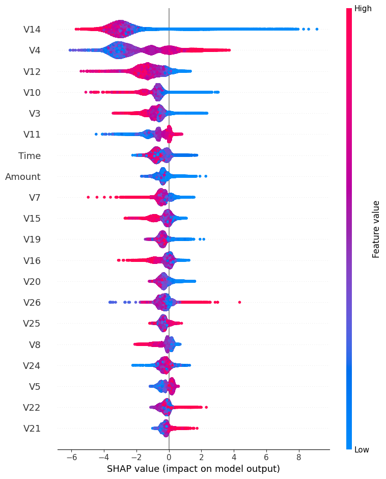

# Detecção de Fraude em Cartões de Crédito 💳🛡️

Este projeto foi desenvolvido como parte do desafio de Machine Learning da DIO (Digital Innovation One). O objetivo é construir um modelo preditivo capaz de identificar transações fraudulentas em cartões de crédito, lidando com um cenário de dados altamente desbalanceados.

## 📌 O Problema
O grande desafio deste dataset não é a complexidade das variáveis, mas sim o **desbalanceamento extremo** dos dados: apenas **0,17%** das transações são fraudes. 

Por isso, a métrica de acurácia é inútil aqui (um modelo "burro" que diz que todas as transações são normais acertaria 99,83% das vezes). O foco da avaliação foi direcionado para o **Recall, Precisão e F1-Score** da classe de fraude (classe 1), além da curva Precision-Recall (PR AUC).

## 🛠️ Preparação dos Dados
- **Dataset**: O arquivo foi carregado diretamente via URL (`https://storage.googleapis.com/download.tensorflow.org/data/creditcard.csv`), respeitando o limite de 100 MB do GitHub sem precisar subir o arquivo para o repositório.
- **Padronização**: As variáveis `Time` e `Amount` foram padronizadas utilizando o `StandardScaler` do Scikit-Learn. As demais variáveis (`V1` a `V28`) já são componentes PCA originais do dataset, garantindo a privacidade dos dados.
- **Split Estratificado**: Utilizou-se `train_test_split` com `stratify=y` para garantir que a proporção de fraudes fosse mantida tanto no conjunto de treino quanto no de teste (30%).

## 📊 Comparação dos Modelos
Foram treinados três modelos, todos lidando com o desbalanceamento através de pesos de classe (`class_weight='balanced'` para Regressão e Random Forest, e `scale_pos_weight` para o XGBoost).

| Modelo | Precisão (Fraude) | Recall (Fraude) | F1-Score (Fraude) | PR AUC |
| :--- | :--- | :--- | :--- | :--- |
| Regressão Logística | 0.07 | 0.88 | 0.12 | 0.7406 |
| Random Forest | 0.97 | 0.70 | 0.82 | 0.8152 |
| **XGBoost** | **0.89** | **0.78** | **0.83** | **0.8345** |

O **XGBoost** apresentou o melhor equilíbrio geral (F1-Score e PR AUC), sendo escolhido para o ajuste final.

## ⚙️ Ajuste de Limiar (Threshold) e SHAP
- **Ajuste de Limiar**: O limiar padrão de 0.5 foi reduzido para **0.3** no XGBoost. Com isso, conseguimos manter um Recall de 0.78 e uma Precisão de 0.87, demonstrando como o ajuste fino do threshold pode ser calibrado para o risco de negócio (priorizando não deixar passar fraudes).
- **Explicabilidade com SHAP**: Para entender o que o modelo aprendeu, foi utilizado o `TreeExplainer` do SHAP. O gráfico abaixo mostra o *Summary Plot*, revelando quais variáveis tiveram o maior impacto na decisão do modelo, destacando a importância de features como `V14`, `V4` e `V12` para a detecção das anomalias.

## 🔄 O que mudei em relação à Expert (Diferenciais)
- **Ajuste de Threshold**: Fui além do padrão de 0.5 e testei o limiar de 0.3 para demonstrar na prática o *trade-off* entre Precisão e Recall no contexto de fraudes.
- **Scale_Pos_Weight**: No XGBoost, utilizei o cálculo nativo da biblioteca `scale_pos_weight` para lidar com o desbalanceamento, em vez de apenas replicar o `class_weight`.
- **SHAP**: Implementei a explicabilidade do modelo utilizando a biblioteca SHAP para abrir a "caixa preta" do XGBoost.

## 🔗 Acesso ao Projeto
- [Acesse o Notebook completo aqui](./deteccao_fraude.ipynb)
- [Dataset original](https://storage.googleapis.com/download.tensorflow.org/data/creditcard.csv)

---
*Projeto desenvolvido por Lucas Lima como parte do curso de Dados com Python e IA - Santander Open Academy.*
